# Lynx EUC HUD

A small heads-up display for the **Lynx electric unicycle (EUC)**, built on a **LilyGO T-Display AMOLED (ESP32-S3)**. The ESP32 connects to the wheel over **Bluetooth Low Energy**, reads live speed and PWM (how hard the motor is working), and shows them on the AMOLED screen. It mounts under the helmet's visor peak with GoPro-style parts.

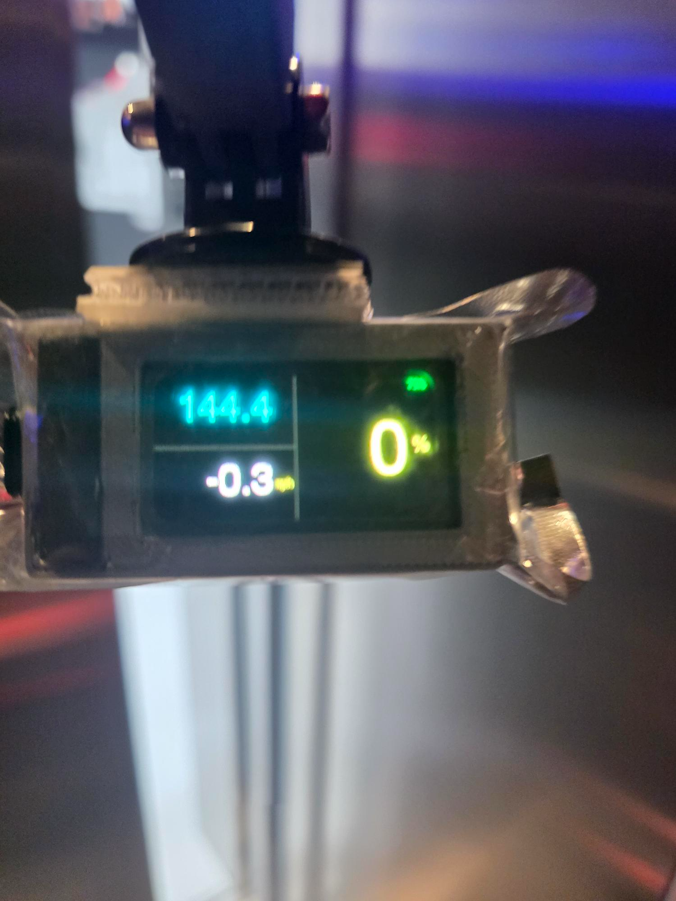 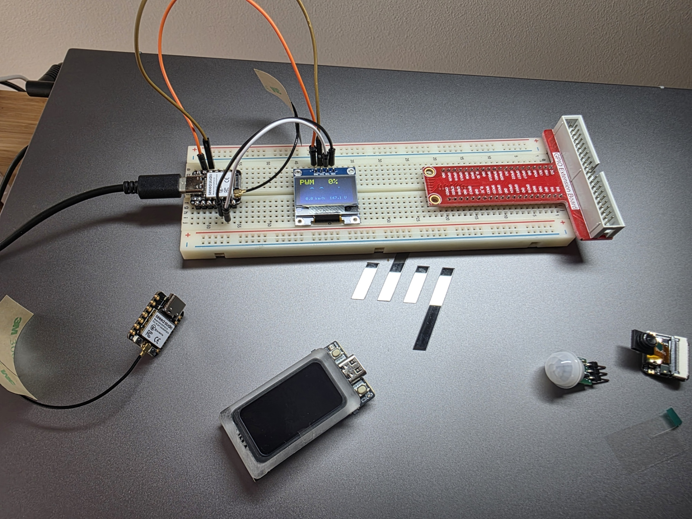

| On the helmet | Under the visor peak | Case and battery | Case close-up |
|---|---|---|---|
| 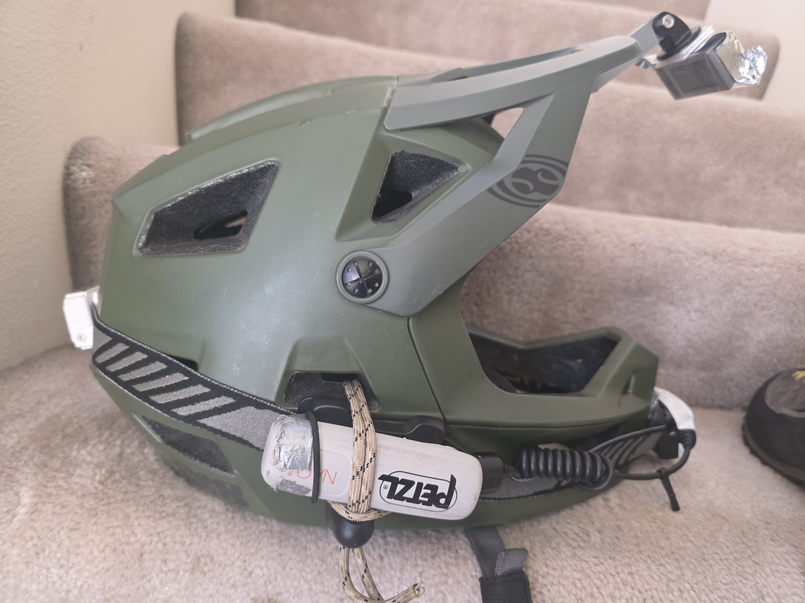 | 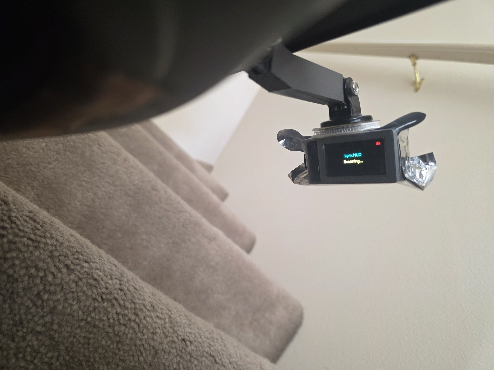 | 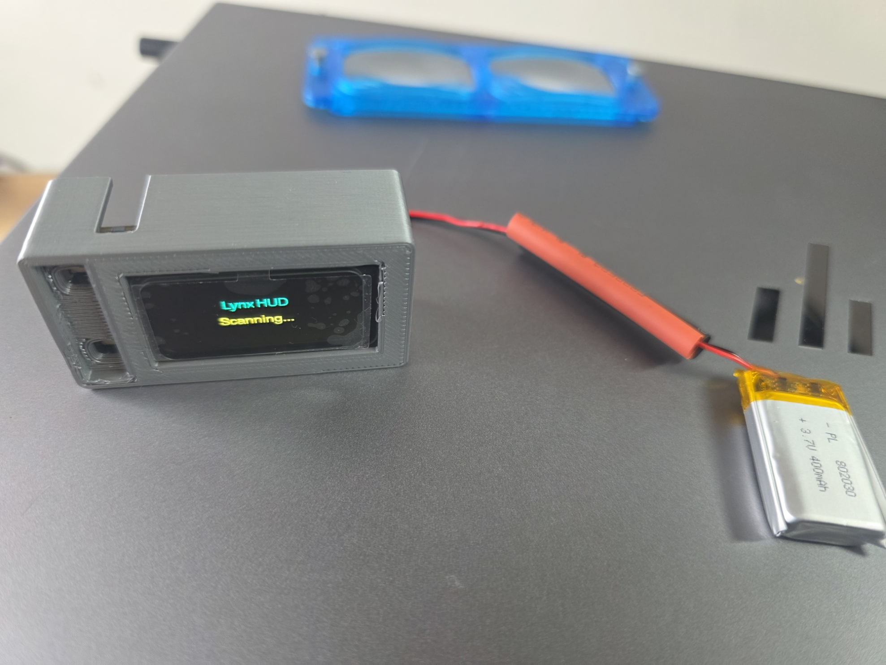 | 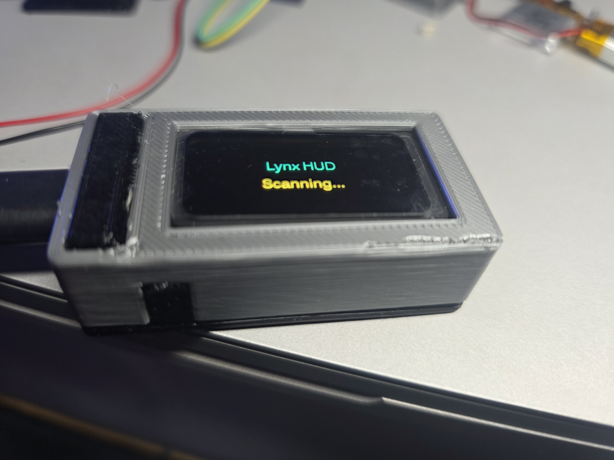 |

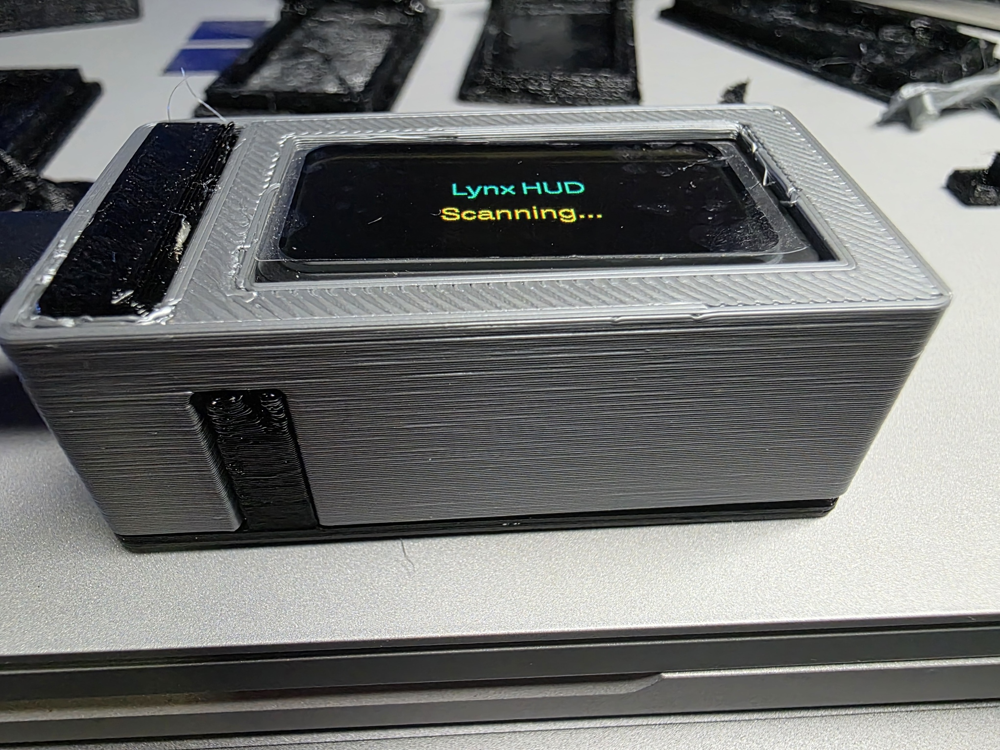

> Work in progress: a learning project covering hardware, Arduino code, and 3D printing.

## Renders

| Case | Cover | Buttons | Helmet bar |
|---|---|---|---|
| 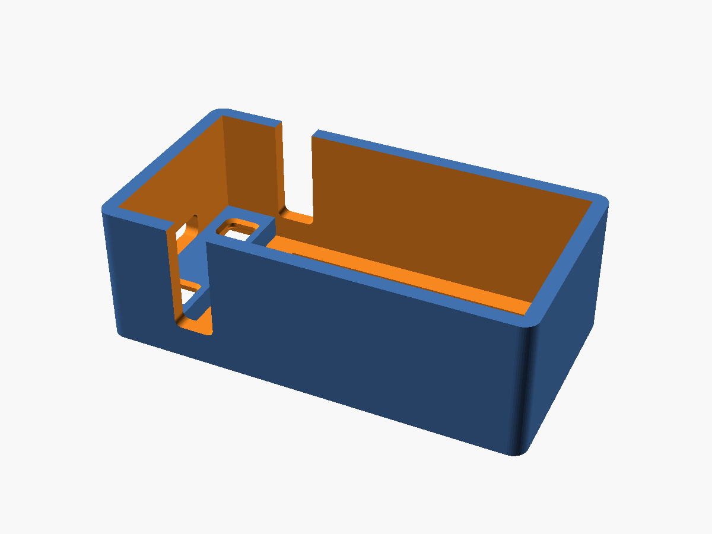 | 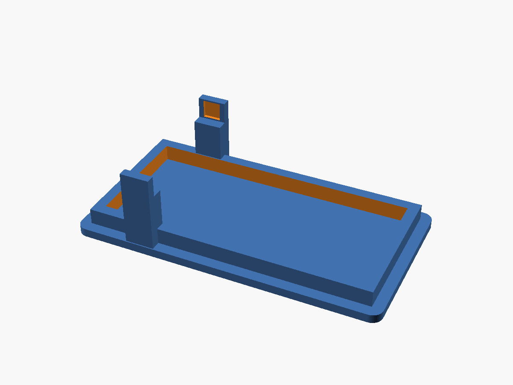 | 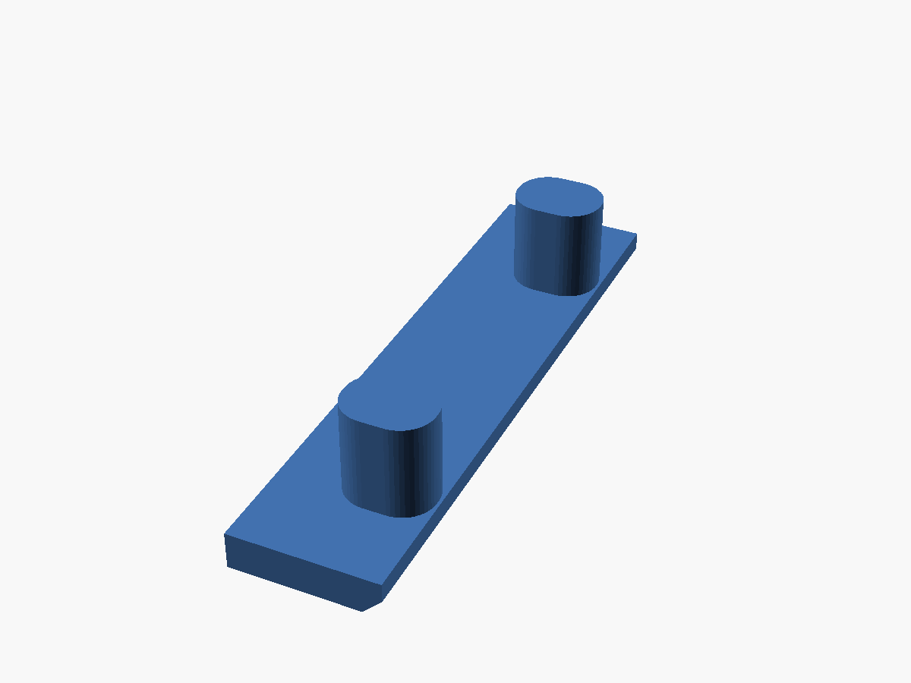 | 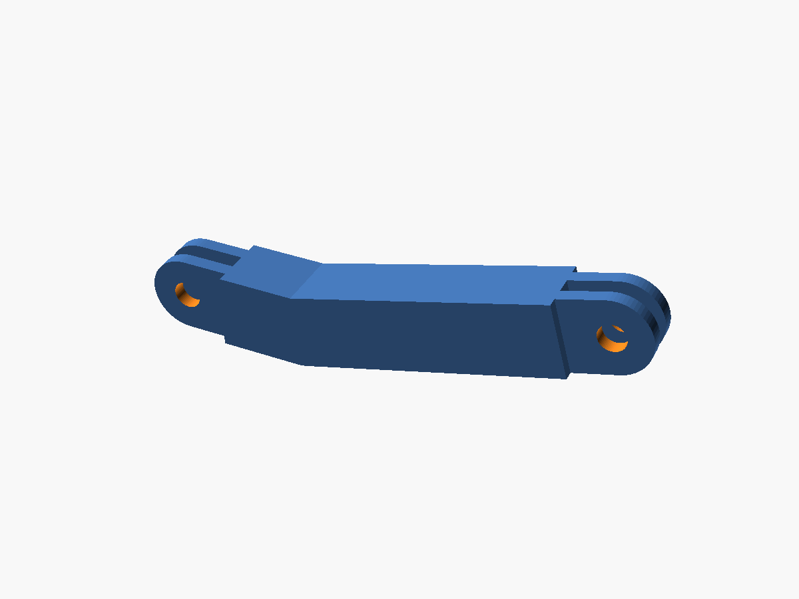 |

Tip: click any `.stl` file in `3d-print/stl` to rotate it in GitHub's 3D viewer.

## Features

- Connects to the Lynx over Bluetooth LE and shows live speed and PWM
- Battery percentage on screen, with a `+` while charging
- Hold the BOOT button for 2 seconds to sleep ("Release to sleep" shows on screen), and tap it to wake
- Goes to deep sleep on its own if it can't find the wheel for 60 seconds, with the screen and its power turned off
- Stays awake while plugged into a computer over USB, so uploading and serial debugging aren't interrupted
- Shows "Woke up" or "Updated" at startup so you can tell why it restarted

## Hardware

- LilyGO T-Display AMOLED (ESP32-S3) with a 3.7 V 400 mAh 1S LiPo battery
- Lynx EUC (BLE)
- 3D-printed case (PLA or PETG), plus a cover and buttons in flexible TPU
- Flexible USB-C plugs to keep moisture out of the charging port

> Tip: the case is sized to fit the LiPo inside. If you'd rather power the HUD over USB-C, you can leave the battery out and print a shorter case.

- GoPro mount parts: a curved adhesive base, arms, the printed bent 2-prong bar, and a flat 3-prong adhesive mount on the case

## Recommended tools

- [Arduino IDE](https://www.arduino.cc/en/software) with the ESP32 board package, to build and upload the firmware
- [OpenSCAD](https://openscad.org/), to edit the case and mount designs (`.scad`) and export STLs
- [PrusaSlicer](https://www.prusa3d.com/page/prusaslicer_424/), to slice the STLs (printed on an Original Prusa i3 MK3S+)
- [nRF Connect](https://www.nordicsemi.com/Products/Development-tools/nRF-Connect-for-mobile), a phone app for finding your wheel's Bluetooth address
- [VS Code](https://code.visualstudio.com/), optional, for editing the sketches, `.scad` files and README
- [GitHub CLI](https://cli.github.com/) (`gh`), optional, for cloning and managing the repo

### Quick install (Windows)

All of these package IDs were checked with `winget show`:

```powershell
winget install -e --id ArduinoSA.IDE.stable
winget install -e --id OpenSCAD.OpenSCAD
winget install -e --id Prusa3D.PrusaSlicer
winget install -e --id Microsoft.VisualStudioCode
winget install -e --id Git.Git
winget install -e --id GitHub.cli
```

Useful VS Code extensions for this project:

```powershell
code --install-extension antyos.openscad                      # preview .scad files in OpenSCAD
code --install-extension leathong.openscad-language-support   # OpenSCAD syntax and autocomplete
code --install-extension ms-vscode.cpptools                   # C/C++ editing for the .ino sketches
code --install-extension davidanson.vscode-markdownlint       # tidy README edits
```

## Repo layout

```
firmware/
  Lynx_BLE_LG_live/   current HUD sketch (live speed + PWM)
  Lynx_BLE_LG/        earlier BLE connect step
  Lynx_BLE_chars/     BLE characteristic explorer
  OLED_Hello/         first display test
3d-print/
  scad/               OpenSCAD sources (editable)
  stl/                ready-to-slice STLs
photos/               build photos and renders
```

## Firmware

1. Install the Arduino IDE and the ESP32 board package, and select an ESP32-S3 board.
2. Set up your wheel (see below).
3. Open `firmware/Lynx_BLE_LG_live/Lynx_BLE_LG_live.ino` and upload it.


### Configure your wheel

The sketch only connects to your own wheel, matched by its Bluetooth address. That address is kept in a small `config.h` file that is **not** committed (it's listed in `.gitignore`).

1. In the sketch folder, copy `config.example.h` to `config.h`.
2. Set `WHEEL_MAC` to your wheel's Bluetooth address in lowercase, for example:

   ```cpp
   #define WHEEL_MAC "aa:bb:cc:dd:ee:ff"
   ```

3. To find the address, turn the wheel on and scan with a BLE scanner app such as nRF Connect.

## 3D printing

The STLs in `3d-print/stl` were sliced in PrusaSlicer for an Original Prusa i3 MK3S+. The cover and buttons are printed in flexible TPU filament (1.75 mm, 200–220 °C). Print TPU slowly. For the bent helmet bar, lay the long section flat and use "support on build plate only".

To change a design, edit the `.scad` file and export it again:

```
openscad -o bent_bar.stl 3d-print/scad/bent_bar.scad
```

## Helmet mount

Curved adhesive base under the visor peak, then GoPro arms, then the printed 15° bent 2-prong bar (it lets the HUD sit level and higher in view), then a flat 3-prong mount stuck to the case. Each joint is held by a thumbscrew.

## Made with Grok Bot

This project was built step by step with help from Grok Bot, an AI desktop assistant. It helped with the BLE firmware, the sleep and power handling, the OpenSCAD case and helmet mount designs, and this repo.

## License

[MIT](LICENSE)
